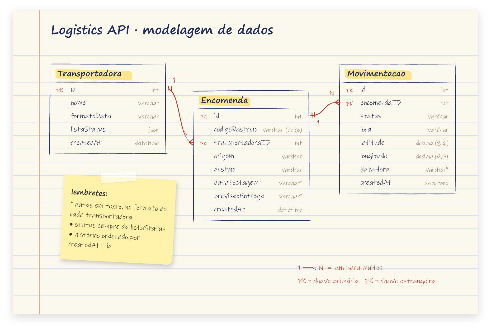

# Logistics API

API mock de **rastreamento de encomendas entre transportadoras**, desenvolvida para a atividade *Representação de Dados e Interoperabilidade* da disciplina de **Sistemas Distribuídos** (IFCE Tianguá).

## Contexto

Uma plataforma de comércio eletrônico trabalha com várias transportadoras, e cada uma registra as etapas da entrega com informações e códigos próprios.

Esta API faz o papel do **Grupo C (API mock)** do *Estudo de Caso 2*: fornece encomendas, códigos de rastreio, transportadoras, localizações, datas, previsões de entrega e histórico de movimentações. Ela é consumida pela aplicação cliente do **Grupo D**, que apresenta o histórico, calcula o tempo de transporte e identifica atrasos.

### Desafio de interoperabilidade

Como os dados vêm de transportadoras diferentes, a API reproduz de propósito as inconsistências do mundo real, que o cliente precisa padronizar:

- **Status com nomes diferentes para a mesma etapa**, como `EM_TRANSITO`, `IN_TRANSIT` e `EM ROTA`.
- **Datas e horários em representações diferentes**, como ISO 8601 com fuso, timestamp Unix ou formato brasileiro `dd/mm/aaaa`.

## Modelagem de dados



### Decisões de modelagem

- **Datas das transportadoras são texto (`Varchar`).** `dataPostagem`, `previsaoEntrega` e `dataHora` são gravadas exatamente como cada transportadora as envia. Converter para um tipo de data no banco eliminaria a inconsistência que o cliente precisa resolver.
- **A ordenação usa `createdAt` e `id`, e não `dataHora`.** Como `dataHora` está em quatro formatos diferentes, ordenar por ela como texto daria um resultado errado (`"02/12/2026"` viria antes de `"21/11/2026"`). O `createdAt` é controlado pela API e está sempre no mesmo formato, então o histórico é ordenado por ele, com o `id` como desempate.
- **`listaStatus` é só uma lista, sem mapeamento para um status padrão.** A API informa quais códigos cada transportadora usa, mas não diz qual código equivale a qual. Fazer essa equivalência é tarefa do cliente.
- **O status de uma movimentação precisa pertencer à `listaStatus` da transportadora.** O banco não consegue garantir isso, porque uma chave estrangeira não aponta para dentro de um campo JSON. A regra fica numa validação do model `Movimentacao`, e um status inválido é recusado com erro 400.
- **O status atual de uma encomenda não é guardado.** Ele é sempre a última movimentação do histórico, o que evita ter a mesma informação em dois lugares.

## Rotas

Todas as rotas começam com **`http://localhost:3000/api/v1`** e respondem em JSON. O arquivo [`docs/insomnia.json`](docs/insomnia.json) pode ser importado no Insomnia com exemplos de todas as requisições.

A documentação interativa (Swagger) fica em **http://localhost:3000/docs**. Por enquanto, ela cobre as rotas `GET /transportadora` e `POST /transportadora/create`. Veja [Documentação com Swagger](#documentação-com-swagger) para documentar as demais.

### Respostas de erro

| Código | Quando acontece | Corpo |
|---|---|---|
| `400` | Dados inválidos ou campo obrigatório ausente | `{ "errors": ["mensagem", ...] }` |
| `404` | Registro não encontrado | `{ "error": "mensagem" }` |
| `500` | Erro interno | `{ "error": "Internal server error" }` |

### Transportadora

| Método | Rota | Descrição |
|---|---|---|
| `GET` | `/transportadora` | Lista as transportadoras |
| `GET` | `/transportadora/:id` | Busca uma transportadora pelo id |
| `GET` | `/transportadora/:id/encomendas` | Busca uma transportadora junto com as suas encomendas |
| `POST` | `/transportadora/create` | Cadastra uma transportadora |
| `PUT` | `/transportadora/update/:id` | Atualiza uma transportadora |
| `DELETE` | `/transportadora/delete/:id` | Remove uma transportadora |

**Filtro de `GET /transportadora`:**

| Parâmetro | Busca | Exemplo |
|---|---|---|
| `nome` | Parcial | `/transportadora?nome=express` |

**`GET /transportadora/:id/encomendas`** devolve a transportadora com o campo `Encomendas`. Assim o cliente recebe, numa só requisição, as encomendas e as informações necessárias para interpretá-las (`formatoData` e `listaStatus`). Responde 404 se a transportadora não existir.

Todos os campos são obrigatórios. Responde `201` com a transportadora criada.

### Encomenda

| Método | Rota | Descrição |
|---|---|---|
| `GET` | `/encomenda` | Lista as encomendas |
| `GET` | `/encomenda/:id` | Busca uma encomenda pelo id, com transportadora e histórico |
| `GET` | `/encomenda/rastreio/:codigoRastreio` | Busca uma encomenda pelo código de rastreio, com transportadora e histórico |
| `POST` | `/encomenda/create` | Cadastra uma encomenda |
| `PUT` | `/encomenda/update/:id` | Atualiza uma encomenda |
| `DELETE` | `/encomenda/delete/:id` | Remove uma encomenda |

**Filtros de `GET /encomenda`** (podem ser combinados):

| Parâmetro | Busca | Exemplo |
|---|---|---|
| `transportadoraID` | Exata | `/encomenda?transportadoraID=2` |
| `codigoRastreio` | Exata | `/encomenda?codigoRastreio=GX000001004BR` |
| `origem` | Parcial | `/encomenda?origem=Recife` |
| `destino` | Parcial | `/encomenda?destino=Fortaleza` |
| `include` | Inclui o histórico | `/encomenda?include=movimentacoes` |

Sem filtros, devolve todas as encomendas. Não existem filtros por data ou por status padronizado, porque o servidor não interpreta os formatos das transportadoras (isso é tarefa do cliente).

**`GET /encomenda/rastreio/:codigoRastreio`** é a rota principal de rastreio. As movimentações vêm sempre em ordem cronológica de registro. Responde 404 se o código não existir.


**`PUT` e `DELETE`** (em encomenda e transportadora) respondem com a quantidade de registros afetados: `[1]` no `PUT` e `1` no `DELETE`. Uma resposta `[0]` ou `0` significa que o id não existe.

**A exclusão é em cascata.** Remover uma transportadora remove também as suas encomendas e o histórico delas, e remover uma encomenda remove o seu histórico.

### Movimentacao

| Método | Rota | Descrição |
|---|---|---|
| `GET` | `/movimentacao/list` | Lista as movimentações, em ordem cronológica de registro |
| `POST` | `/movimentacao/create` | Registra um novo evento no histórico de uma encomenda |

**Filtros de `GET /movimentacao/list`:**

| Parâmetro | Busca | Exemplo |
|---|---|---|
| `encomendaID` | Exata | `/movimentacao/list?encomendaID=14` |
| `status` | Exata, com o código da transportadora | `/movimentacao/list?status=IN_TRANSIT` |

O `status` precisa estar na `listaStatus` da transportadora da encomenda, e a `dataHora` deve seguir o `formatoData` dela. Um status inválido é recusado.

Não existem rotas para editar ou remover movimentações: um histórico de rastreio só recebe eventos novos.

## Tecnologias

- **Node.js** + **Express 5**: servidor HTTP
- **Sequelize** + **SQLite**: persistência em um arquivo local, sem instalar banco de dados
- **Swagger UI** + **swagger-jsdoc**: documentação interativa gerada a partir dos comentários `@openapi` nos arquivos de rotas

## Como rodar localmente

### 1. Instalar o Node.js (versão 20 ou superior)

**Windows:** baixe o instalador **LTS** em https://nodejs.org e siga o assistente.

**Linux / WSL / macOS:** recomendado usar o [nvm](https://github.com/nvm-sh/nvm):

```bash
curl -o- https://raw.githubusercontent.com/nvm-sh/nvm/v0.40.1/install.sh | bash
# feche e reabra o terminal
nvm install --lts
```

Confira a instalação:

```bash
node -v   # deve mostrar v20.x ou superior
npm -v
```

### 2. Clonar o repositório

```bash
git clone https://github.com/WilghanerSilva/logistics-api.git
cd logistics-api
```

### 3. Instalar as dependências

```bash
npm install
```

### 4. Iniciar o servidor

```bash
npm run dev     # modo desenvolvimento (reinicia ao salvar arquivos)
# ou
npm start       # modo normal
```

O servidor sobe em **http://localhost:3000**. A documentação interativa fica em **http://localhost:3000/docs**.

O banco `database.sqlite` é **versionado no repositório**, para que todos usem os mesmos dados mock. Se você alterou os dados localmente e quer voltar ao estado original: `git checkout database.sqlite`.

### Variáveis de ambiente (opcionais)

| Variável | Padrão | Descrição |
|---|---|---|
| `PORT` | `3000` | Porta do servidor |
| `DB_STORAGE` | `database.sqlite` | Arquivo do banco (`:memory:` para banco em memória) |

Exemplo: `PORT=8080 npm run dev`

## Estrutura do projeto

```
├── database.sqlite      # banco com os dados mock (versionado)
├── docs/
│   ├── insomnia.json    # coleção de requisições para importar no Insomnia
│   └── modelagem.png    # diagrama da modelagem de dados
└── src/
    ├── server.js        # inicializa o banco e sobe o servidor
    ├── app.js           # configuração do Express, Swagger e tratamento de erros
    ├── swagger.js       # configuração do OpenAPI
    ├── database.js      # conexão Sequelize/SQLite
    ├── Models/          # tabelas, validações e relacionamentos (index.js)
    ├── Routes/          # URLs de cada recurso e comentários @openapi
    ├── Controllers/     # leitura da requisição e montagem da resposta
    └── Services/        # consultas ao banco
```

## Problemas comuns

- **`npm install` falha ao compilar o `sqlite3`:** confirme que está usando Node 20 ou superior (`node -v`). Versões antigas não têm binário pré-compilado.
- **`EADDRINUSE: address already in use`:** a porta 3000 já está ocupada. Use outra com `PORT=3001 npm run dev`.
- **O `/docs` não mostra uma rota recém-documentada:** confira se o caminho no comentário `@openapi` é o completo (começando com `/api/v1`) e se a indentação do YAML está correta. Se estiver tudo certo, encerre o `npm run dev` (Ctrl+C) e rode de novo.
- **O `/docs` abre sem rotas:** o servidor precisa ser iniciado pela raiz do projeto (`npm run dev` ou `npm start`), porque o `swagger-jsdoc` procura os arquivos de rotas em `./src/Routes`.
